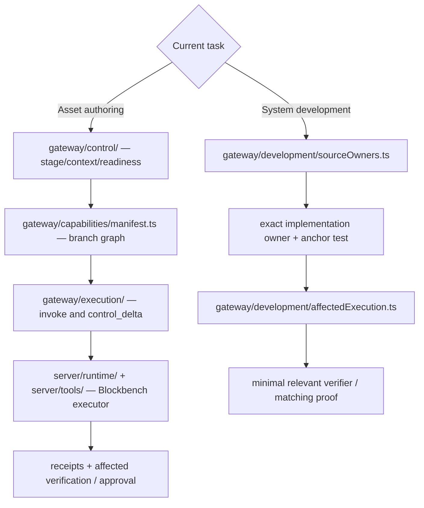

# LazyDesigner Implementation Map

Updated: 2026-10-20

This file maps **current source ownership only**. Product workflow belongs in `docs/01-product/flow.md`; AI context loading in `docs/04-system/ai-context-loading.md`; continuation/proof in `docs/05-operations/`.

## Architecture

```text
ChatGPT Reference Preparation
→ Reference Package
→ LazyDesigner Control
→ Codex
→ Gateway
→ Runtime
→ Plugin
→ Blockbench native APIs
```

There is one authoring system. Supporting docs/Skills/QA may project or interpret state; they do not create alternate Runtime, routing, or authored-state systems.

## Navigation graph: source owner to proof

This diagram **links existing owners**; it does not generate capability metadata,
define a new runtime graph, or require extra reads on the Codex hot path.
Follow only the branch relevant to the active task.



| Question | Canonical owner | Next read only when needed |
| --- | --- | --- |
| Which Stage/specialist now? | `gateway/control/` + `lib/capabilities/authoringStage.ts` | `docs/04-system/authoring-stage-context.md` for cross-stage ambiguity |
| Which tool and prerequisites? | `gateway/capabilities/manifest.ts` + `graph.ts` | Runtime tool schema for execution |
| Which tool is actually exposed? | `server/runtime/registration.ts` + `getMcpSurfaceDescriptor` | Live `tools/list` and current Gateway Runtime catalog when executable proof is needed |
| What state/evidence was invalidated? | `gateway/control/delta/` + `lib/orchestration/` | affected current evidence |
| Who fixes capability source? | `gateway/development/sourceOwners.ts` | exact module + `anchor_test` |
| Which tests are affected? | `gateway/development/affectedExecution.ts` | focused verifier |
| What is proven? | `docs/05-operations/current-validation.md` | exact-SHA executed CI/native evidence |

A branch without `graph` metadata is **not automatically defective**:
some tools need only Runtime validation. `READY/UNKNOWN/BLOCKED` describes
known prerequisites, **not Runtime registration, execution success, or visual
approval**. A capability in the core/branch manifest (including an `active`
lifecycle entry) may be prewired while absent from the registered Runtime
surface; only the actual catalog can establish availability. For example,
`manage_uv_layout` and `construct_geometry` remain unregistered, while
`manage_cubes` and `paint_texture_transaction` use registered executors.
Do not infer activation from a schema, source module, Skill, or manifest.
The AI-facing Control search projection additionally marks `UNKNOWN` when
branch-specific prerequisites exist but the operation branch is absent or
unrecognized; it retains `BLOCKED` when already established. The caller must
describe/select the operation before interpreting readiness. This is a
discovery presentation guard, **not a change to graph evaluation, native
schema acceptance or semantic revision**. The graph-owner correction still
requires generator-aligned semantic/API evidence.  Never infer
source ownership from a capability's semantic similarity or a diagram arrow.
If the exact owner exists, do not traverse document navigation again.

## Documentation architecture route

For a missing documentation relationship, use [Repository Knowledge Architecture](knowledge-architecture.md). It projects exact authored links with witnesses to Markdown/Mermaid; existing Source Owners, Semantic Impact, TypeScript reachability, Control and Runtime Capability Graph remain separate canonical owners.

**Cross-owner proof planning:** the opt-in `mcp/scripts/development/plan-development-context.ts --evidence-chain` produces a read-only composition of the existing routing owner, explicit capability source/test declarations and affected check plan. It must not imply that authored document links prove source dependencies or that planned regressions were run. See [Repository Knowledge Architecture](knowledge-architecture.md).

## Canonical Skills

### Reference Preparation

```text
.agents/skills/lazydesigner-reference-preparation/SKILL.md
.agents/skills/lazydesigner-prompt-compiler/SKILL.md
.agents/skills/lazydesigner-pixel-art-authoring/SKILL.md
.agents/skills/lazydesigner-particle-reference-authoring/SKILL.md
```

### Asset Authoring

```text
Geometry / hierarchy / pivots / UV → lazydesigner-modelling
Texture / Painter / PBR            → lazydesigner-texturing
Animation / effects/controllers    → lazydesigner-animation
routing/context selection          → LazyDesigner Control
```

Semantic stage and Runtime surface are intentionally separate concepts:

```text
semantic stage  GEOMETRY  → Runtime surface AUTHORING
semantic stage  TEXTURING → Runtime surface AUTHORING
semantic stage  ANIMATION → Runtime surface ANIMATION
```

`mcp/lib/capabilities/authoringStage.ts` is the single mapping owner. Geometry↔Texturing is a semantic-owner/focus change inside the same AUTHORING surface; only AUTHORING↔Animation is a true Runtime surface boundary.

### Product Development

```text
MCP public/protocol contracts       → lazydesigner-mcp-development
Blockbench/runtime/plugin mechanics → lazydesigner-blockbench-development
complex cross-owner design          → lazydesigner-development-brief
```

Clear bounded development changes go directly to the exact source owner.

### Skill System

```text
Skill activation / routing / evaluation / consolidation
→ lazydesigner-skill-development
```

This owner changes Skill execution guidance and evaluation semantics only. It does not replace durable product/system policy or Product Development owners.

## Control

Canonical source: `mcp/gateway/control/`.

```text
referencePackage.ts    compact Reference Package projection
workspace.ts           Active Workspace projection
contextProjection.ts   GEOMETRY/TEXTURE/ANIMATION Stage projection
packet.ts              task packet/readiness/context delivery
delta/                  post-operation invalidation/control delta
snapshot.ts             Gateway/Runtime orientation
capabilities.ts         capability decoration
gatewayProjection.ts    bounded client-facing Control projection
index.ts                canonical Control exports
```

Control owns product context selection, projection and lifecycle orientation. It may project bounded `SYSTEM_DEVELOPMENT` results, but it does not own repository-development diagnosis, source-owner mappings, Tool schemas, Runtime execution, live authored state, Skill prose or build execution.

Compatibility paths `control/developmentIntent.ts`, `control/sourceOwners.ts`, `control/sourceOwners/**`, and `control/registry.ts` are not implementation owners.

## Data lifecycle

`docs/04-system/data-lifecycle.md` owns the data safety contract. `mcp/scripts/development/data-inventory.ts` is a derived, on-demand Git-tracked audit with no independent state. `apps/desktop/src-tauri/src/metadata_io.rs` protects only small Desktop-owned metadata written by `project_navigation.rs`, never native asset files.

## Gateway Development Intelligence

Canonical source: `mcp/gateway/development/`.

```text
intent.ts                    bounded SYSTEM_DEVELOPMENT intent routing
sourceOwners.ts              capability → source/specialist/anchor lookup
sourceOwners/                domain-specific source-owner maps
impact.ts                    changed-path semantic blast radius
semanticArtifact.ts          derived semantic artifact identity
semanticDependencies.ts      owner dependency revisions
semanticDependencyMatrix.ts  engineering verification/check mapping facade
semanticFreshness.ts         compatibility facade to capability freshness core
semanticInvalidation.ts      scoped invalidation planning
affectedExecution.ts         affected execution/verification planning
```

For a capability without an exact source mapping, Development Intelligence falls back to `mcp/server/runtime/registration.ts` as the Runtime **surface owner** plus the matching specialist. It must not route ownership to legacy compatibility facades or guess an implementation file.

The canonical `affectedExecution.ts` turns changed source paths into a bounded verifier plan. Agent permissions, repository governance, system-document routing, knowledge indexing and developer source ownership require repository contract checks; changed knowledge/context and source-owner implementations also select their concrete developer regression tests. Unknown and toolchain changes still fail safe to full verification. No automatic CI is triggered. New Development consumers import `gateway/development/sourceOwners.ts` directly; `gateway/control/sourceOwners.ts` is a compatibility-only re-export.

## Gateway Execution

Canonical source: `mcp/gateway/execution/`.

```text
capabilityExecutor.ts  capability dispatch, precondition, Control receipt/delta,
                       session fact updates and result compaction
gatewayErrors.ts        AI-facing execution error/result adaptation
benchmarkTrace.ts       opt-in execution benchmark trace writer
```

Execution may coordinate Control and Runtime. Runtime transport must not depend back on execution.

## Gateway


Public AI-client surface is fixed:

```text
status
search_capabilities
describe_capability
invoke_capability
```

Owners:

```text
mcp/gateway/index.ts                         stable public boundary + Control wiring
mcp/gateway/runtime/backend.ts               Runtime adapter/catalog/queue/project affinity
mcp/gateway/runtime/connectionManager.ts     demand-driven Runtime connection lifecycle
mcp/gateway/runtime/runtimeSession.ts        Runtime connection/session observability
mcp/gateway/session/state.ts                  process-local capability facts + Control continuation
mcp/gateway/session/orchestrationRecoveryState.ts
                                               verification/correction recovery + project epoch
mcp/gateway/runtime/reconnectPolicy.ts       bounded reconnect backoff
mcp/gateway/contracts/protocol.ts            canonical Gateway protocol/base types
mcp/gateway/contracts/outputSchemas.ts       canonical public output validation contracts
mcp/gateway/capabilities/effects.ts          declarative capability effect application
mcp/gateway/control/receipt.ts               project/phase receipt derivation
mcp/gateway/runtime/recovery.ts              structured recovery semantics
mcp/gateway/presentation/statusProjection.ts normalized public status
mcp/gateway/presentation/resultCompaction.ts result/receipt compaction
mcp/gateway/providers/registry.ts            bounded Gateway-local provider registry
mcp/gateway/runtime/projectAffinity.ts       Gateway compatibility facade for affinity contracts
mcp/lib/runtime/affinity.ts                    canonical project/stage affinity headers/contracts
```

Gateway owns client stability and Runtime recovery. It does not own Blockbench mutation implementations or authoring workflow reasoning.

## Runtime

Runtime is the capability registry/validator/executor boundary.

```text
mcp/server/net.ts
→ stateless HTTP/MCP transport
→ request serialization / runtime-generation safety
→ project + phase affinity enforcement

mcp/server/runtime/registration.ts
→ registration profile
→ family ownership
→ canonical phase surface descriptor/cache

mcp/server/runtime/consolidatedRoutes.ts
→ family + discriminator + branch→executor descriptors

mcp/server/runtime/consolidatedTools.ts
→ routing-only public wrappers
→ retained original executors remain canonical implementation

mcp/server/runtime/phaseControl.ts
→ semantic focus change + AUTHORING↔Animation Runtime handoff receipt

mcp/server/runtime/bootstrap.ts
→ exactly-once Runtime initialization only

mcp/server/runtime/extensions.ts
→ canonical Runtime extension composition order
→ explicit per-extension target manifest

mcp/server/runtime/contracts/texture.ts
mcp/server/runtime/contracts/animation.ts
→ domain-specific Runtime contract enrichment

mcp/server/tools/**
→ authored Geometry / Texture / Animation / Particle / inspection / export implementations

mcp/server/tools/animation.ts
→ Animation facade only: ordered docs + compatibility re-exports + focused registrar aggregation

mcp/server/tools/animation/create.ts
mcp/server/tools/animation/keyframes.ts
mcp/server/tools/animation/timeline.ts
mcp/server/tools/animation/controller.ts
mcp/server/tools/animation/controller*.ts
mcp/server/tools/animation/*Schema.ts
mcp/server/tools/animation/shared.ts
→ canonical Animation capability/schema/helper owners

mcp/server/tools/animation/rigging.ts
mcp/server/tools/animation/batch.ts
→ canonical Animation rigging/batch owners

mcp/server/tools/texture.ts
→ Texture facade only: ordered docs + compatibility re-exports + focused registrar aggregation

mcp/server/tools/texture/create.ts
mcp/server/tools/texture/read.ts
mcp/server/tools/texture/assignment.ts
mcp/server/tools/texture/materials.ts
mcp/server/tools/texture/*Schema.ts
mcp/server/tools/texture/materialState.ts
→ canonical Texture creation/read/assignment/material/schema/state owners

mcp/server/tools/texture/atlas.ts
→ canonical Texture atlas owner

mcp/server/tools/paint.ts
→ Paint facade only: ordered docs + compatibility re-exports + focused registrar aggregation

mcp/server/tools/paint/primitives.ts
mcp/server/tools/paint/brush.ts
mcp/server/tools/paint/settings.ts
mcp/server/tools/paint/selectionLayers.ts
mcp/server/tools/paint/shared.ts
→ canonical Paint primitive/brush/settings/selection-layer/shared owners

mcp/server/tools/element.ts
→ Element facade only: ordered docs + focused registrar aggregation

mcp/server/tools/element/mutation.ts
mcp/server/tools/element/hierarchy.ts
mcp/server/tools/element/discovery.ts
mcp/server/tools/element/shared.ts
→ canonical Element mutation/hierarchy/discovery/shared owners
```

Additional canonical tool domains:

```text
mcp/server/tools/geometry/cubes.ts
→ Cube authoring + Cube geometry/UV mutation owner

mcp/server/tools/element/inspection.ts
→ existing inspect_element / inspect_elements(mode=detail) read-only Cube
  inspection; opt-in Recipe-owned optimization report delegates to
  mcp/server/runtime/recipes/authoring/service.ts, which composes the
  canonical mcp/lib/authoringRecipe/service.ts and planning.ts.
  The pure mcp/lib/authoringRecipe/optimizationCounterfactual.ts helper
  uses the existing incremental Recipe planner for one zero-spaced LINEAR
  draft only; no live removal, new checker or tool family is introduced.
  No separate optimizer, tool family, or direct Apply is registered here.

mcp/server/tools/project/project.ts
→ project creation/info/bounds owner

mcp/server/tools/particle/manage.ts
mcp/server/tools/particle/inspection.ts
mcp/server/tools/particle/fileTransaction.ts
→ Particle execution / inspection / filesystem transaction owners
```

Additional canonical support domains:

```text
mcp/server/tools/geometry/locators.ts
→ Locator lifecycle/mutation owner

mcp/server/tools/inspection/camera.ts
→ visual framing / screenshot inspection owner

mcp/server/tools/validation/qualityIntelligence.ts
mcp/server/tools/validation/qualityEvidenceRuntime.ts
→ bounded Runtime quality/validation augmentation owners

mcp/server/tools/io/export.ts
mcp/server/tools/io/import.ts
→ model IO owners

mcp/server/tools/state/history.ts
→ Undo/Redo/checkpoint state owner

mcp/server/tools/interaction/ui.ts
→ Blockbench interaction/UI tool owner

mcp/server/tools/texture/renderProfile.ts
→ render-profile resource owner
```

Representative focused owners:

```text
manage_locator / manage_null_object
→ mcp/server/tools/geometry/locators.ts

manage_material_instances
→ material instances owner under mcp/server/tools/**

manage_animation_controller
→ animation controller owner under mcp/server/tools/**
```

`mcp/server/tools.ts` remains a thin compatibility facade/bootstrap boundary; it is not the owner of Runtime state anymore.

## Visual Asset Expansion — Source to Runtime Closure

**Invocation-scoped output receipt classification (source-wired):**
`mcp/gateway/execution/capabilityExecutor.ts` now supplies the
Backend-verified native project UUID and invocation arguments to the
existing `buildControlDelta`. The focused Control consumer
`mcp/gateway/control/delta/outputReceipt.ts` reuses canonical
`planAssetOutputRequirements` and `reviewAssetOutputReceipts`
for only `export_model` (project / geometry / animation) and
`manage_particle`. It classifies reported readback as `receipt_only`
for that invocation, and compile-only / size-only / rejected evidence as
`focused_read` with a concrete next intent. This changes the **existing**
Control Delta verification/continuation decision, not public fields,
persistent receipt storage, native writers, or Finalization acceptance.
The existing `gateway/control/orchestration.ts` now interprets output
`next_intent` at the continuation boundary: verified write readback can
continue with explicit requested-output/approval debt; Particle JSON write
still requires a focused resource/texture review. An open cohort now retains the **specific kind** of outstanding Particle
resource/texture review and requested export-output/approval review in its
existing bounded `pending_verification.output_reviews`, even when another
receipt follows. Cohort completion surfaces the owed review rather than a
generic focused read, while preserving a higher-priority visual, recovery,
status or handoff decision. The same ephemeral cohort also tracks `verification_domain` for the
strongest pending check. A later Animation/CORE receipt cannot retarget an
earlier Geometry/Texture/Animation visual scope; equally strong cross-domain
visual debt becomes an explicitly unscoped, untargeted multi-domain review.
No cross-domain Cube camera capture is recommended. These internal facts
are not a new registry, Gateway output field, evidence store or proof of
overall asset acceptance. Size-only and compile-only outcomes describe their exact
remaining work; unknown write outcome retains no-auto-retry safety.
Local provider results and cached/session UUIDs cannot obtain this
native receipt classification. Focused regressions:
`mcp/tests/export-lifecycle-control-delta.test.ts` (NOT_EXECUTED).

**Control output-context continuity (source-only):**
`mcp/gateway/control/outputEvidence.ts` compares a bounded captured
Control project binding, Runtime generation, Reference/Workspace fingerprints
and task-context identity with a later Control Packet, then composes the
existing `lib/receipts/assetOutput.ts` reviewer. Project, Runtime-generation or Reference identity differences and
unavailable bound context withhold positive revision claims. Workspace
and task IDs may rotate after an authorized save: only the exact
Finalization-native current file digest (not those IDs) can still match
the specific saved Entity file. The existing
Finalization-only Entity `.bbmodel` digest can yield only
`CONTROL_CHECKPOINT_MATCH_REPORTED` when its accepted/current hash
matches a file readback receipt **and** the same-status bound Runtime
requested project's absolute native `save_path` exactly matches the
receipt's `wrote_to_path`. Save As to a different file with identical
bytes is not same-deliverable proof; absent Runtime status/native path
withholds a positive comparison. Matching
contexts alone cannot prove a native revision: manual editor edits may not
rotate Control identifiers. Particle and other output types remain
`UNVERIFIED` until native format-specific readback exists. No new state,
public Gateway tool, Runtime writer, or generated schema.
Focused owner: `mcp/gateway/control/outputEvidence.test.ts`.

**Native receipt bridge (source-only):**
`mcp/lib/receipts/assetOutput.ts` reviews exact `export_model`
structuredContent (Entity project/geometry/animation) and existing
`isVerifiedParticleWriteReceipt` (Particle JSON) against planned
deliverables. It distinguishes compile-only, size-only, native-reported
readback and Particle write receipt without claiming current revision,
authenticity, visual acceptance or completion. Missing native owners stay
explicitly `NATIVE_ROUTE_UNAVAILABLE`; this is **not** a second
exporter, receipt store, validation engine or Gateway route. Focused
`mcp/tests/contracts/asset-output-receipt-contract.test.ts`
covers valid/invalid producer shapes and fail-closed ownership.

**Source-only output requirements:** `mcp/lib/product/assetOutputContracts.ts`
owns the per-profile FILE/HANDOFF/REVIEW deliverable plans, projected from
the existing `assetProfiles.ts` `output_contract` identity (not a second
Asset Profile registry). `planAssetOutputRequirements` resolves required,
explicitly requested and referenced outputs; a missing referenced inventory
retains an unresolved conditional rather than dropping a Particle texture.
It never checks file bytes, invokes a native tool, writes Resource Packs or
authorizes Finalization. `mcp/tests/asset-output-contracts.test.ts` owns the
positive/negative source contract. The existing native export, Texture and
Particle owners remain the only execution paths.

**Asset Profile source owner:** `mcp/lib/product/assetProfiles.ts` declares
seven output-intent profiles, category, authoring-domain eligibility, output
quality gate applicability and output contract identity. Its source-only
`resolveAssetProfileSelection` rejects unknown, ambiguous or incompatible
legacy Reference identities; modelling `selected_profile` never selects an
Asset Profile. Particle may author on the ANIMATION Runtime Surface without
a model Animation clip requirement. `mcp/lib/authoring/assetHealth.ts` and
`mcp/gateway/control/readiness.ts` accept an **explicit internal** profile
for applicability; unqualified helper calls remain Entity-default. Non-Entity
Finalization does not accept Entity-only `.bbmodel` checkpoint checks.
The existing public Reference `selected_profile` is a modelling subtype, not an Asset Profile,
and no new public `asset_profile_id` is yet generated or selected by Control.
The existing v1 `asset.kind` now selects only internal Entity/Particle
applicability at Control packet assembly. Finalization and Gateway-facing
Workspace summary exclude Entity-native `.bbmodel` stale evidence for
Particle, while its own output remains unverified.
No non-Entity planner becomes registered by this contract. A real multi-asset
handoff must update the canonical Reference generator, consumers, semantic
revision and generated API together, with native outputs independently proved.

**Repository source assessment (2026-11-07):** the approved product scope is in [Visual Asset Expansion](../01-product/visual-asset-expansion.md). This map describes *existing source ownership and true call paths*, not a second feature registry, executable product claim, or a new Control router. All new F0–S1 source regressions remain `NOT_EXECUTED`, and native/Gateway availability requires live Runtime evidence.

| Milestone | Pure contract / nearest source owner | Existing actual Runtime/export relationship | Closure boundary |
| --- | --- | --- | --- |
| **F0** | `mcp/lib/bedrock/blockVisualCompatibility.ts` | Pure input to B1/C1; no registered feature/tool by itself | Target-version checks are advisory; no block resource output |
| **A1** | `mcp/lib/bedrock/attachableBinding.ts` | A2 consumes A1; existing `server/tools/geometry/locators.ts` manages native locators/bones in Bedrock Entity | No attachable binding executor or built holder/slot evidence |
| **A2** | `mcp/lib/bedrock/attachableContextPreview.ts` | `server/tools/inspection/camera.ts` owns `capture_model_views` of the current model | Model-only images are not holder+equipment first/third-person composite captures |
| **B1** | `mcp/lib/bedrock/blockVisualPlanning.ts` | C1 consumes B1; `server/tools/project/project.ts` creates `Formats.bedrock` (Entity), not a Block project | No custom-block project format/codec or proven game culling |
| **I1** | `mcp/lib/texture/itemIconPlanning.ts` | Current `get_texture` and `mcp/lib/texture/pixelCraft.ts` offer native Texture/image evidence and craft diagnostics | No item-atlas/PNG export writer or `item_texture.json` registration |
| **T1** | `mcp/lib/texture/blockFlipbookPlanning.ts` | Native Texture fields and Pixel Art reference are separate from a Bedrock flipbook resource | No native `flipbook_textures.json` exporter or Resource Pack installer |
| **V1** | `mcp/lib/texture/appearanceVariantContinuity.ts` + `variantPlan.ts` | **Existing source-wired path:** `server/runtime/registration.ts` → `extensions.ts` → `contracts/texture.ts` wires `create_texture(type=variant)`, uses `planTextureVariantFromBase`, then precommit source/variant RGBA + native face-UV checks and returns `structuredContent.variant_creation` with optional `variant_native_continuity`; `get_texture` and `list_textures` retain existing reads | Native texture-only subset is **source-wired, not executed here**. Full V1 Geometry/Material/rig/Render Controller selection remains source-only; no visual or Minecraft PASS |
| **C1** | `mcp/lib/bedrock/blockInteractionBounds.ts` | Pure B1+F0 composition; no physical interaction executor | No Behavior Pack collision/selection writer or gameplay proof |
| **S1** | `mcp/lib/texture/classicSkinPlanning.ts` | PixelCraft reused; normal `create_project` and `export_model` remain Bedrock Entity | No native Skin project authoring/skin-pack codec or game acceptance |

**Retired scope:** Fog/E1 was removed at user request because it does not belong to the Blockbench asset-authoring workflow. It is not a retained domain, executor, output target or planned capability.

### Closest complete integration path

1. **V1 texture-only source wiring present, runtime evidence pending.** The existing `create_texture(type=variant)` now reconciles source and created texture UUID/group/bitmap bytes, project identity, and native mapped-face UV before Undo commit. First close the source/receipt compatibility review and obtain future *actual* Blockbench observation; the source-wired `variant_native_continuity` field is not live PASS today. The full Entity Geometry/Material/rig Render Controller V1 profile remains separately unintegrated.
2. **Then A1/A2 native equipment evidence.** Keep current Geometry/Locator/Camera ownership; do not promote model-only captures to holder-composite passes. Use a verified holder model/pose and actual perspective capture before a native fit claim.
3. **Then I1/T1 source-to-texture output.** Build only explicitly authorized, format-correct output adapters from actual Texture/PNG/atlas evidence; do not silently assemble entire Resource/Behavior Packs or route Pixel Art through Animation/Particle.
4. **B1/C1 and S1 require separate native format/output decisions.** Current `export_model` supports Bedrock Entity geometry, `.bbmodel` project and content-only Bedrock animation. Do not pass off existing Entity codecs as a custom block, collision, or skin pack exporter.

**Source closure for focus switch (2026-11-07):** the V1 Texture-only executor and `capture_model_views` Camera observation are **SOURCE_WIRED / REGRESSION_AUTHORED_NOT_RUN**, not native acceptance. V1's transaction-local appearance identity guards render/animation settings during Undo and redraw; Camera withholds a stable part-correspondence receipt when before/after capture dependency coverage is `UNVERIFIED`. A1/A2, B1/C1, I1, T1 and S1 remain independent native/codec/output milestones. A model-only capture does not close A2 holder-composite evidence. The public Gateway remains exactly four tools.

**P0 Capability Graph boundary:** `gateway/capabilities/graph.ts` still returns `READY` when no Graph prerequisites exist, while search/Control mitigations return `UNKNOWN` for unselected or graphless mutations. This is **not resolved** by the V1/Camera source closure. The first complete P0 semantic change must include exact-branch behavior, affected consumers, owning regressions, semantic revision and canonical generated API/HTML on the same SHA. No manual edits of generator outputs or partial Graph owner changes.

Before authoring any new Runtime schema or capability, inspect the actual registered catalog and dependent generators. Semantic schema changes must move with their generator-owned API outputs; while generators are unavailable, complete independent source/regression work only. Current proof is **SOURCE_REVIEWED**; executable Bun/Blockbench/Minecraft checks are not performed.

## Shared Runtime Libraries

Canonical shared-library domains:

```text
mcp/lib/authoring/   handoff readiness + validator semantics
mcp/lib/bedrock/     Bedrock project identity + authored project semantics
mcp/lib/product/     LazyDesigner product identity
mcp/lib/protocol/    MCP/resource URI helpers
mcp/lib/runtime/     Runtime connection/affinity/fetch/lifecycle primitives
```

Root `mcp/lib/*.ts` files for migrated owners are compatibility re-export facades only; new code should target the canonical domain path.

```text
mcp/lib/capabilities/metadata.ts   canonical tier/search aliases/declarative effects + Operation/State/Execution/Verification projection
mcp/lib/authoring/assetDependencyGraph.ts canonical Dirty Scope → Domain + minimum downstream recheck projection

gateway/control/orchestration.ts
→ ephemeral per-task Verification Cohort accumulation
→ optional task_context_id + explicit CONTINUE/COMPLETE boundary
→ never replaces native per-tool Undo/rollback
mcp/lib/capabilities/authoringStage.ts       semantic stage classification + AUTHORING/ANIMATION surface mapping
mcp/lib/authoring/authoringReadiness.ts  canonical Animation handoff readiness
mcp/lib/authoring/validationVerdict.ts   conservative Validator gate projection
mcp/lib/receipts/**             shared Runtime→Control mutation receipt contracts
mcp/lib/authoring/semanticHistory.ts      ephemeral WeakMap semantic Undo/Redo effects
mcp/lib/factories.ts           Tool/Resource/Prompt registration + canonical validation/result compaction
mcp/lib/runtime/lifecycle.ts    runtime generation/lifecycle safety helpers
```

Domain intelligence helpers under `mcp/lib/**` remain supporting implementation for the owning Tool family; they are not alternate public capabilities.

## Plugin / Blockbench Integration

```text
mcp/index.ts
→ plugin orchestration only

mcp/plugin/runtimeHost.ts
→ native network permission
→ Runtime listener bind/start/close/config ownership

mcp/plugin/blockbenchIntegration.ts
→ i18n/settings/UI/prompts/reference-resource integration
→ corresponding teardown

mcp/plugin/reload.ts
→ single native LazyDesigner plugin reload owner
→ shared by human recovery UI and development sync

mcp/plugin/devSync.ts
→ development file watcher/build identity only
→ delegates reload to the shared plugin reload owner
```

Native network/listener/UI/settings/reload ownership must not migrate back into `mcp/index.ts`. Human recovery and development sync must not create separate reload paths.

## Tool Capability Rule

Consolidation means:

```text
public capability
→ declarative route
→ original retained executor
→ original validation/native intelligence
```

It does **not** mean replacing several implementations with a weaker generic implementation. Capability/intelligence reduction is not an efficiency strategy.

## Validation / QA / Gates

```text
quality intelligence
→ bounded diagnostic evidence only
→ `server/tools/validation/qualityIntelligence.ts`: hygiene / rig graph / color / optimization / root-motion / animation-quality diagnostics
→ `server/tools/validation/qualityEvidenceRuntime.ts`: deterministic surface-integrity / physical-UV / motion-craft evidence
→ both augment existing canonical read tools through the ordered `server/runtime/extensions.ts` pipeline
→ neither creates a second public capability catalog, approval system, or quality score

Blockbench Validator
→ BLOCKED | REVIEW_REQUIRED | VALIDATOR_CLEAR
→ never visual/user approval

Control readiness
→ workspace/reference lifecycle orientation
→ never handoff authorization by itself

mcp/lib/authoring/authoringReadiness.ts
→ USER_APPROVED | AUTONOMOUS_VERIFIED
→ actual AUTHORING↔Animation readiness contract
```

Visual/reference PASS remains evidence-based and separate from technical success.

## Zero-Waste Token Efficiency

Current source owners are `mcp/gateway/control/contextHeadroom.ts` for deterministic
headroom projection and `mcp/gateway/control/packet.ts` plus `delta/` for compact
context/continuation delivery. The [Zero-Waste design snapshot](zero-waste-token-efficiency-plan.md)
is historical rationale, not an active implementation queue. Current continuation is
owned by [next-action.md](../05-operations/next-action.md); matching source/proof determines
what is actually implemented and accepted. Do not add AI summarizers/planners,
persistent observation state or capability loss as an efficiency shortcut.

## Context / Knowledge

Canonical context owners:

```text
docs/04-system/ai-context-loading.md
docs/04-system/authoring-stage-context.md
docs/04-system/control/context-projection.md
docs/04-system/prompt-cache-and-compaction.md
docs/04-system/skill-taxonomy.md
```

Normal asset work loads one active specialist. Geometry may additionally load exactly one selected primary modelling profile. Shared Stage Context is a reusable semantic contract, not a Skill/router/manager.

For **repository-development knowledge**, reuse existing source owners rather than introducing a second registry:

```text
development intent / source ownership → mcp/gateway/development/intent.ts + sourceOwners.ts
source/capability dependencies          → mcp/gateway/development/semanticDependencyMatrix.ts
Markdown section identity + ranking    → mcp/lib/semantic/knowledge.ts
bounded developer retrieval             → mcp/scripts/development/plan-development-context.ts
optional Markdown section index         → mcp/scripts/development/build-knowledge-index.ts
```

The semantic dependency matrix models implementation/capability relationships; it is **not** proof of a complete document-link knowledge graph. Knowledge section IDs are path/heading-scoped and derived, while canonical policy authority remains with the selected document. Do not promote search similarity into evidence of a source relationship.

## Reference Package

One canonical machine-readable package:

```text
REFERENCE.json
schema = lazydesigner-reference-v1
asset.kind = MODEL | PARTICLE
```

Reference Preparation owns reference facts; Control projects the compact active-stage subset. The package never becomes a live Runtime-state database.

## Particle Ownership

Particle is Animation-specialist asset support, not a fourth authoring phase.

```text
inspect_particle / manage_particle
→ mcp/server/tools/particle/manage.ts

particle bitmap authoring
→ existing Texturing capabilities

particle timing/locator binding
→ manage_animation_effects
```

No parallel Particle paint/save pipeline is allowed.

## Animation Controller Ownership

```text
inspect_animation
→ read-only Animation/Controller inspection

manage_animation_controller
→ one controller mutation surface

animation-controller-native-intelligence.ts
animation-runtime-resource-intelligence.ts
→ bounded intelligence extensions composed by `server/runtime/extensions.ts`
```

These extensions do not create additional controller tools/profiles.

## Workspace / Persistence

```text
workspace/active/<asset>/README.md
→ durable human-readable current asset continuation
```

Workspace state is not Runtime connection/session state and is not duplicated inside Control.

## Build / Verification / Distribution

```text
mcp/build/**         Runtime bundle/watch + prompt-manifest build input
mcp/scripts/generate/** generated docs/schema owners
mcp/scripts/verify/** verification/freshness owners
mcp/scripts/operations/** local deploy/setup/live-sync operations
mcp/scripts/**       engineering/measurement/benchmark/reporting harnesses
distribution/**      product-level managed distribution
mcp/prompts/**       canonical Runtime prompt source + manifest
mcp/tests/**         contract/integration regressions
```

Completed one-shot retirement/finalization workflows and migration scripts do not remain in the active repository surface. Generated API/prompt outputs are generator-owned and must not be hand-edited.

Test inventory, affected selection and staged retirement are governed by
[the canonical test architecture](test-architecture.md). Use the existing
`gateway/development/affectedExecution.ts` planner, not a second test router.
On-demand `scripts/development/audit-test-inventory.ts` only identifies
review candidates and never deletes tests or constitutes a quality PASS.

### Bun-first toolchain, without runtime lock-in

- `.bun-version` pins the Gateway/test/build/package toolchain. Do not
  auto-upgrade it or regenerate `mcp/bun.lock` from a different runtime
  without same-source regression, benchmark and Windows package evidence.
- `mcp/gateway/index.ts` executes through Bun. `mcp/build/index.ts`
  uses `Bun.build(target=node, format=cjs)` to emit a Blockbench plugin
  bundle; that plugin uses the editor's own JavaScript/native APIs rather
  than running Bun *inside* Blockbench.
- Desktop remains Tauri/Rust with Node/npm frontend tooling. Keep
  Geometry/Texture/Animation pure decision algorithms independent of
  Bun-specific APIs; isolate toolchain and native-editor requirements
  at their existing owners. No parallel engine or generic adapter graph.
- Manual `MCP Verify` supports `full` (canonical source/build gate) and
  `texture` (four focused regressions plus TypeScript typecheck). The
  default/missing selection stays `full`; focused PASS has a distinct
  evidence scope and cannot certify full verification or native visuals.
- The managed Windows package keeps an explicit, security-bounded source
  allowlist in `distribution/managed-install.ts`. The
  `managed-skill-package-references.test.ts` repository contract checks
  live specialist reference files against that allowlist, avoiding a
  filesystem-dependent package manifest at runtime.

## Compatibility Boundary

The active **source distribution** now uses canonical LazyDesigner identities:

```text
manager        lazydesigner.exe
plugin bundle  lazydesigner_mcp.js
BBPlugin id    lazydesigner_mcp
client config  mcp_servers.lazydesigner
protocol/env   x-lazydesigner-*, LAZYDESIGNER_*
package        lazydesigner-package.json
managed root   %LOCALAPPDATA%/LazyDesigner/managed
```

The older BlockIT executable, plugin and configuration identifiers are retained only for read-only detection of pre-existing installations and explicit, consented migration. Some deprecated TypeScript symbol aliases remain source-only. Do not run a second legacy Runtime or treat a source rename as an installed/native PASS. Persisted Blockbench authoring Stage and extended-family setting IDs are separate compatibility contracts; review before changing them.

## Proof Boundary

Source ownership and contracts can be established remotely. Installed Runtime freshness, persistent-Gateway recovery, native Blockbench mutation behavior, playback/persistence, visual fidelity and measured whole-task efficiency require matching local/live evidence.


## Desktop Control Plane

Canonical source:

```text
apps/desktop/
```

Ownership:

```text
apps/desktop/src/App.svelte
→ page/dialog composition, action admission and ephemeral UI state
→ explicit user actions only

apps/desktop/src-tauri/src/system_status.rs
→ Blockbench process/install discovery
→ Blockbench executable identity + version projection
→ canonical compatibility-manifest projection
→ typed managed-status projection
→ maintenance availability
→ client-owned Gateway supervision guidance
→ explicit Open Blockbench bridge
→ bounded update / repair / recover delegation

mcp/compatibility/blockbench.json
→ single Blockbench compatibility-policy owner

distribution/
→ status / install / update / repair / recover / rollback implementation
→ package integrity / staging / transaction / immutable-version ownership
```

Desktop is a machine/lifecycle sidecar, not part of the authoring hot path:

```text
AI client → Gateway → Runtime → Blockbench
```

Desktop must not become a second Control, Gateway, Runtime, updater, compatibility table, authored-state database, or background watchdog.

Gateway process lifecycle remains MCP-client-owned. Desktop may project `healthy | waiting-runtime | client-disconnected | runtime-offline | idle` and recovery guidance, but it does not start/kill/restart a Gateway stdio process.

Desktop maintenance actions are deliberately distinct:

```text
update  → release lookup/stage/activate through Managed Distribution
repair  → same active immutable source SHA; no upgrade
recover → interrupted transaction recovery
```

Frontend page, dialog, observation and operation owners are documented in the
[Desktop README](../../apps/desktop/README.md#frontend-module-ownership).
The Desktop verifier definition is retained in `.github/disabled-workflows/desktop-verify.yml`
while CI is disabled; no automatic or manual dispatch is implied. Cross-owner repository
invariants are guarded by `mcp/tests/repository/desktop-control-plane-contract.test.ts`.
